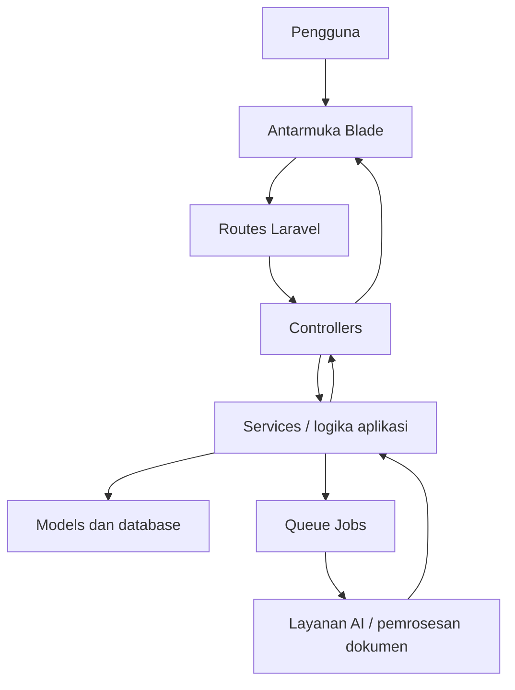

<div align="center">

# SIMBA
### Sistem Informasi Manajemen Belajar Adaptif

**Learning Management System berbasis web dengan dukungan Artificial Intelligence untuk membantu pengelolaan pembelajaran, penyediaan materi, dan analisis progres belajar.**

[](https://laravel.com/)
[](https://www.php.net/)
[](https://tailwindcss.com/)
[](https://vite.dev/)

[Repository](https://github.com/Alfsen13/SIMBA) · [Laporkan masalah](https://github.com/Alfsen13/SIMBA/issues)

</div>

---

## Daftar Isi

- [Tentang SIMBA](#tentang-simba)
- [Fitur dan modul](#fitur-dan-modul)
- [Teknologi](#teknologi)
- [Gambaran arsitektur](#gambaran-arsitektur)
- [Struktur proyek](#struktur-proyek)
- [Persyaratan sistem](#persyaratan-sistem)
- [Instalasi](#instalasi)
- [Menjalankan aplikasi](#menjalankan-aplikasi)
- [Konfigurasi AI](#konfigurasi-ai)
- [Pengujian](#pengujian)
- [Keamanan](#keamanan)
- [Status pengembangan](#status-pengembangan)
- [Kontribusi](#kontribusi)
- [Lisensi](#lisensi)

## Tentang SIMBA

**SIMBA (Sistem Informasi Manajemen Belajar Adaptif)** adalah aplikasi Learning Management System (LMS) berbasis web yang dikembangkan menggunakan Laravel. Proyek ini dirancang untuk mendukung pengelolaan aktivitas pembelajaran dan mengintegrasikan kemampuan AI ke dalam alur belajar.

Selain fungsi LMS, rancangan SIMBA mencakup pemanfaatan **Retrieval-Augmented Generation (RAG)** untuk membantu AI menjawab pertanyaan berdasarkan dokumen pembelajaran, serta analisis data pembelajaran untuk mendukung pemantauan progres siswa.

> Catatan: ketersediaan dan perilaku setiap fitur bergantung pada implementasi, konfigurasi layanan eksternal, dan versi kode yang sedang digunakan. Bagian yang masih berupa rancangan tidak boleh dianggap sebagai fitur produksi yang telah tervalidasi.

## Fitur dan modul

Area fitur utama SIMBA meliputi:

- **Manajemen pembelajaran** — pengelolaan data dan aktivitas pembelajaran melalui aplikasi web.
- **Integrasi AI dan RAG** — rancangan alur pengambilan konteks dari dokumen pembelajaran untuk membantu menghasilkan jawaban yang relevan.
- **Ekstraksi dokumen** — dukungan pustaka pemrosesan PDF; pipeline ekstraksi lanjutan dapat memerlukan dependensi Python tambahan.
- **AI Tutor** — asisten pembelajaran yang dirancang untuk memanfaatkan konteks dokumen dan layanan AI.
- **Pembuatan soal dan tugas berbantuan AI** — mendukung alur generasi materi evaluasi melalui layanan AI.
- **Analisis progres belajar** — pengolahan indikator pembelajaran untuk membantu memantau perkembangan siswa.
- **Prediksi nilai dan klasifikasi risiko belajar** — area analitik yang menggunakan pendekatan machine learning; hasilnya perlu dievaluasi dan tidak menggantikan penilaian pendidik.
- **Antarmuka interaktif** — Blade, Alpine.js, Tailwind CSS, Chart.js, dan KaTeX untuk kebutuhan antarmuka, visualisasi, serta penulisan rumus.

Fitur AI dapat memerlukan API key, konfigurasi model, dependensi tambahan, worker antrean, atau layanan lokal. Pastikan konfigurasi pada kode dan file `.env.example` sesuai sebelum menjalankannya.

## Teknologi

| Area | Teknologi |
|---|---|
| Backend | PHP, Laravel 13 |
| Template antarmuka | Laravel Blade |
| CSS | Tailwind CSS 4 |
| Interaktivitas | Alpine.js |
| Build frontend | Vite |
| Visualisasi | Chart.js |
| Render rumus matematika | KaTeX |
| Database | MySQL/MariaDB atau database lain yang didukung konfigurasi Laravel |
| Pemrosesan PDF | `smalot/pdfparser`, `barryvdh/laravel-dompdf` |
| Machine learning PHP | `php-ai/php-ml` |
| Autentikasi API | Laravel Sanctum |
| Pengelolaan dependensi PHP | Composer |
| Pengelolaan dependensi frontend | npm |
| Pengujian | Pest / Laravel test runner |
| Server lokal opsional | FrankenPHP dan Caddy, melalui konfigurasi proyek |

Versi dependensi yang sebenarnya mengikuti `composer.json`, `composer.lock`, `package.json`, dan `package-lock.json` di repositori.

## Gambaran arsitektur

Secara umum, aplikasi menggunakan pola MVC Laravel dengan pemisahan tanggung jawab ke controller, model, layanan aplikasi, dan antrean pekerjaan bila diperlukan.



Alur tersebut merupakan gambaran konseptual. Detail implementasi suatu fitur dapat berbeda sesuai controller, service, job, dan konfigurasi yang tersedia di versi repositori.

### Alur RAG (konseptual)

1. Dokumen pembelajaran dimasukkan ke sistem.
2. Dokumen diekstrak menjadi teks dan diproses menjadi potongan teks (*chunks*).
3. Potongan teks disiapkan untuk proses embedding dan penyimpanan.
4. Ketika pertanyaan diajukan, sistem mencari konteks yang relevan.
5. Konteks yang ditemukan digunakan bersama pertanyaan untuk menyusun jawaban melalui model AI.

RAG membutuhkan implementasi embedding, penyimpanan dan pencarian vektor, serta provider model yang dikonfigurasi dengan benar. Diagram ini menjelaskan pendekatan yang dituju, bukan jaminan bahwa semua tahap telah aktif di setiap deployment.

## Struktur proyek

```text
SIMBA/
├── app/                 # Kode inti aplikasi Laravel
├── bootstrap/           # Bootstrap aplikasi
├── config/              # Konfigurasi aplikasi
├── database/            # Migrations, factories, dan seeders
├── lang/                # Berkas bahasa
├── public/              # Entry point dan aset publik
├── resources/           # Blade, CSS, dan JavaScript
├── routes/              # Definisi route
├── storage/             # Log, cache, dan berkas aplikasi
├── tests/               # Pengujian otomatis
├── .env.example         # Contoh konfigurasi environment
├── Caddyfile            # Konfigurasi Caddy/FrankenPHP
├── composer.json        # Dependensi dan skrip Composer
├── package.json         # Dependensi dan skrip frontend
└── vite.config.js       # Konfigurasi Vite
```

Direktori penting:

- `app/` — logika utama aplikasi, termasuk controller, model, dan komponen domain lain.
- `database/` — skema database melalui migration serta data awal jika seeders disediakan.
- `resources/` — template Blade dan aset frontend.
- `routes/` — endpoint web/API yang didaftarkan aplikasi.
- `tests/` — tempat pengujian otomatis.
- `storage/` — penyimpanan runtime; jangan mengunggah data sensitif atau artefak privat ke repositori.

## Persyaratan sistem

Pastikan lingkungan pengembangan memiliki:

- PHP **8.3 atau lebih baru yang kompatibel dengan batasan `composer.json`**.
- Composer.
- Node.js dan npm yang kompatibel dengan versi Vite yang digunakan.
- MySQL/MariaDB atau database lain yang didukung aplikasi.
- Ekstensi PHP yang diperlukan Laravel dan dependensi Composer.
- Kredensial layanan AI apabila fitur AI diaktifkan.
- Dependensi Python/OCR tambahan jika pipeline ekstraksi dokumen tertentu menggunakannya.

Periksa versi yang terpasang:

```bash
php -v
composer --version
node -v
npm -v
```

## Instalasi

### 1. Clone repositori

```bash
git clone https://github.com/Alfsen13/SIMBA.git
cd SIMBA
```

### 2. Instal dependensi

```bash
composer install
npm install
```

### 3. Siapkan file environment

Linux/macOS:

```bash
cp .env.example .env
```

Windows PowerShell:

```powershell
Copy-Item .env.example .env
```

### 4. Atur konfigurasi database

Buka `.env`, kemudian sesuaikan konfigurasi database dengan lingkungan lokalmu. Contoh untuk MySQL:

```dotenv
APP_NAME=SIMBA
APP_ENV=local
APP_DEBUG=true
APP_URL=http://127.0.0.1:8000

DB_CONNECTION=mysql
DB_HOST=127.0.0.1
DB_PORT=3306
DB_DATABASE=simba
DB_USERNAME=root
DB_PASSWORD=
```

Nilai di atas hanya contoh. Buat database terlebih dahulu dan gunakan kredensial yang sesuai dengan sistemmu. Jangan menimpa konfigurasi lain yang dibutuhkan aplikasi; sesuaikan `.env` dengan `.env.example` dan dokumentasi fitur terkait.

### 5. Buat application key dan jalankan migration

```bash
php artisan key:generate
php artisan migrate
```

Jika proyek menyediakan seeder yang memang dibutuhkan, jalankan secara eksplisit setelah memeriksa isinya:

```bash
php artisan db:seed
```

**Perhatian:** `db:seed` tidak wajib untuk semua instalasi dan dapat memasukkan data awal. Periksa seeder terlebih dahulu sebelum menjalankannya.

### 6. Build aset frontend

Untuk pengembangan:

```bash
npm run dev
```

Untuk membangun aset:

```bash
npm run build
```

## Menjalankan aplikasi

### Mode pengembangan standar

Jalankan server Laravel:

```bash
php artisan serve
```

Pada terminal terpisah, jalankan Vite:

```bash
npm run dev
```

Jika fitur menggunakan antrean, jalankan worker pada terminal lain:

```bash
php artisan queue:work
```

Buka URL yang ditampilkan oleh `php artisan serve`, biasanya `http://127.0.0.1:8000`.

### Menjalankan skrip pengembangan Composer

Repositori juga mendefinisikan skrip Composer bernama `dev` dan `franken`. Periksa isi `composer.json` sebelum memilihnya karena skrip tersebut menjalankan beberapa proses sekaligus.

```bash
composer run dev
```

Skrip `franken` dikonfigurasi untuk lingkungan Windows tertentu dan merujuk ke lokasi executable FrankenPHP khusus. Sesuaikan path di `composer.json` dan `Caddyfile` sebelum menggunakannya di komputer lain.

## Konfigurasi AI

Fitur yang terhubung dengan provider AI membutuhkan konfigurasi tambahan. Sebelum mengaktifkannya:

1. Periksa `.env.example` dan konfigurasi di direktori `config/` untuk mengetahui nama variabel yang benar.
2. Isi API key atau pengaturan provider hanya di `.env` lokal atau secret manager deployment.
3. Periksa queue dan worker yang diperlukan oleh proses AI.
4. Pastikan endpoint, nama model, batas penggunaan, dan penanganan kegagalan sudah sesuai dengan provider.
5. Uji proses dengan dokumen dan data non-sensitif terlebih dahulu.

Jangan menambahkan API key, token, password, data siswa, atau dokumen privat ke Git. Nama variabel environment tidak dicantumkan di sini apabila belum dapat dipastikan dari konfigurasi aktual.

## Pengujian

Jalankan pengujian aplikasi dengan:

```bash
php artisan test
```

Atau gunakan skrip yang tersedia:

```bash
composer run test
```

Pastikan konfigurasi database testing dan `.env.testing` (jika digunakan) terpisah dari data pengembangan atau produksi. Hasil tes perlu diperiksa pada lingkungan yang sesuai sebelum melakukan deployment.

## Keamanan

- Jangan commit file `.env` atau kredensial rahasia.
- Gunakan `APP_DEBUG=false` di lingkungan produksi.
- Gunakan kredensial database dengan hak akses minimum.
- Validasi akses dan otorisasi sebelum memproses data pembelajaran atau data pribadi.
- Lindungi dokumen sumber, embedding, log, dan artefak model yang bersifat privat.
- Jangan menganggap prediksi machine learning sebagai keputusan final tentang kemampuan siswa; hasil perlu ditinjau oleh pendidik.
- Sebelum deployment, periksa dependency, konfigurasi storage, permission, backup, dan kebijakan retensi data.

## Status pengembangan

SIMBA merupakan proyek yang terus dikembangkan. Struktur dependensi dan skrip di repositori menunjukkan penggunaan Laravel 13, Tailwind CSS 4, Vite, Alpine.js, Chart.js, KaTeX, serta beberapa pustaka PDF dan machine learning. Keberadaan dependensi saja tidak membuktikan bahwa seluruh fitur yang memakainya sudah lengkap atau tervalidasi.

Untuk mengetahui kondisi terbaru, rujuk kode pada branch aktif dan jalankan pengujian proyek. Dokumentasi sebaiknya diperbarui ketika perilaku fitur, konfigurasi, atau prosedur instalasi berubah.

## Kontribusi

Kontribusi, laporan bug, dan saran pengembangan dapat diajukan melalui [GitHub Issues](https://github.com/Alfsen13/SIMBA/issues) atau Pull Request.

1. Fork repositori.
2. Buat branch baru: `git checkout -b feature/nama-fitur`.
3. Buat perubahan dan tambahkan pengujian yang relevan.
4. Jalankan pengujian.
5. Commit perubahan dengan pesan yang jelas.
6. Push branch dan buat Pull Request.

Jangan sertakan secret, data pengguna, atau berkas lokal yang tidak diperlukan dalam Pull Request.

## Lisensi

Repositori mencantumkan lisensi `MIT` pada metadata `composer.json`. Pastikan file `LICENSE` tersedia dan isi lisensinya sesuai sebelum mendistribusikan proyek.

## Pengembang

Dikembangkan oleh **Alfsen13**.

- GitHub: [@Alfsen13](https://github.com/Alfsen13)
- Repository: [Alfsen13/SIMBA](https://github.com/Alfsen13/SIMBA)
