# Arsitektur Sistem SIMBA

## Pola Arsitektur

**MVC Laravel + Service layer.**

- Generate soal kuis/tugas dan generate pertemuan berjalan **async** via queue terpisah (`ai-soal`, `pertemuan`).
- Remedial massal berjalan **async** di queue `default`.
- Ekstraksi/embedding dokumen RAG tetap **sinkron** via `ProcessDocument::dispatchSync`.
- Generate soal/pertemuan AI tutor streaming/remedial manual per-siswa bisa tetap sinkron tergantung alur.
- **Controller tipis.** Logika domain di `app/Services`.
- **Tidak ada repository layer.**

## Lapisan Sistem

| Lapisan | Isi |
|---------|-----|
| **HTTP / Routing** | `routes/web.php` (Blade + sesi), `routes/api.php` (chat SSE), `bootstrap/app.php` (middleware, provider, exception JSON; **TANPA scheduler**). Middleware alias `'role'` -> `RoleMiddleware`. |
| **Controller** | `app/Http/Controllers/Web/{Auth,Admin,Operator,Guru,Siswa,PengelolaOperator}` dan `app/Http/Controllers/Api/ChatController`. Memanggil Policy untuk otorisasi dan Service untuk logika. |
| **Form Request** | `app/Http/Requests/**` — validasi input, termasuk trait bersama `ValidatesKonteksSoal` & `ValidatesMateriUtama`. |
| **Service (domain)** | `app/Services/**` — AI/RAG, ML, kuis/tugas, remedial, dokumen, chat, Bloom. Sebagian murni array (`SoalTugasService`) tanpa DB/HTTP. |
| **Model (Eloquent)** | `app/Models/**` — relasi, casts, scope; dipakai service & controller untuk baca/tulis. |
| **Job & Queue** | `app/Jobs/**` — `GenerateSoalKuisAI`/`GenerateSoalTugasAI` (queue `ai-soal`, prioritas), `GeneratePertemuanJob` (queue `pertemuan`), `GenerateRemedialAI`/`GenerateRemedialPertemuanAI`/`NilaiRemedialTugasAI`/`PeriksaJawabanTugasAI`/`SaranMateriJob`/`GenerateChatSummary`/`RunPrediksiJob` (queue `default`), `ProcessDocument::dispatchSync` untuk RAG. Queue driver database di dev (3 worker terpisah), sync di test. |
| **Observer** | `app/Observers/**` — efek samping lifecycle model (`MateriObserver` membuat `Document` + `ProcessDocument`; `KelasObserver` membuat `Berita`). |
| **Policy** | `app/Policies/**` — otorisasi kepemilikan (guru pemilik kelas/kuis/tugas/materi, siswa pemilik notifikasi). |
| **Notification (kustom)** | `app/Notifications/**` + `NotifikasiChannel`. **TIDAK** memakai tabel notifications Laravel; semua notifikasi disimpan di tabel `notifikasis`. |
| **View (Blade)** | `resources/views/**` per role + `resources/views/components/**`. Interaktivitas via Alpine.js; grafik via Chart.js (lazy chunk); formula via KaTeX (lazy chunk). |
| **ML (PHP-ML)** | Tiga lapis: (1) skor risiko **DETERMINISTIK** Baseline Deviation Scoring (`PrediksiRisikoService`, tanpa pelatihan) sebagai kategori acuan; (2) SVR kernel linear (php-ml) untuk regresi nilai pertemuan berikutnya; (3) Random Forest 50 pohon / kedalaman 12 sebagai **PEMBANDING**, dilatih dari label baseline (bukan penentu kategori). Artifact di `storage/app/private/ml`; dataset latih bisa disnapshot ke `ml/dataset_latih.json` lewat `DatasetLatihService`. |

## Peran Pengguna

| Peran | Akses |
|-------|-------|
| **operator** | Panel manajemen: verifikasi/tolak user, kelola kelas, validasi pendaftaran siswa ke kelas, upload & proses dokumen RAG, kelola berita, import user, notifikasi. Route prefix `operator.*` (tidak ada prefix admin terpisah). |
| **pengajar** | Mengampu kelas: kelola pertemuan, materi, kuis, tugas, kehadiran, penilaian (manual + AI), rekap nilai + export PDF, prediksi risiko & monitoring, remedial. Route name berawalan `pengajar.*`. |
| **pelajar** | Belajar: ajukan & ikuti kelas, buka pertemuan/materi (jika dibuka), kerjakan kuis & tugas, AI Tutor, lihat nilai, kerjakan remedial. Route name berawalan `pelajar.*`. |
| **pengelola_operator** | Manajemen operator dan kategori mata pelajaran: daftar operator (tambah/edit/hapus), kelola kategori mata pelajaran (CRUD dengan hitungan mata pelajaran). Route name berawalan `pengelola-operator.*`. |

## Status User

`users.status`: `pending` \| `verified` \| `rejected`.

Akun baru (register) status `pending` dan diarahkan ke `/verifikasi-pending`; `RoleMiddleware` memblokir pengajar/pelajar berstatus pending.

## Tech Stack

- `laravel/framework` ^13 (`illuminate/*` >= 8.4.1)
- `laravel/sanctum` (guard API `auth:sanctum`, stateful cookie)
- `barryvdh/laravel-dompdf` (export nilai PDF)
- `php-ai/php-ml` (SVR kernel linear, RandomForest, LeastSquares)
- `smalot/pdfparser` (fallback ekstraksi PDF pure-PHP)
- `tailwindcss` ^4 + `@tailwindcss/vite` (tanpa `tailwind.config.js`; konfigurasi via `@theme`)
- `alpinejs` (interaktivitas inline)
- `chart.js` (grafik prediksi/show, lazy import)
- `katex` (render LaTeX AI Tutor, lazy import)
- `pest` (testing), `laravel/pint` (formatter)
- `python` (`app/Python/extract_text.py`): pdfplumber, pymupdf, tesseract, pix2tex, torch CUDA

## Direktori

| Direktori | Isi |
|-----------|-----|
| `app/Http/Controllers/Web` | Controller Blade per role |
| `app/Http/Controllers/Api` | Hanya `ChatController` (SSE) |
| `app/Services` | Logika domain & integrasi AI |
| `app/Services/Tugas` | 4 kelas domain tugas (`SoalTugasService`, `PengumpulanTugasService`, `TugasService`, `TugasPresenter`) |
| `app/Models` | Eloquent |
| `app/Jobs` | 11 job queue (`ai-soal`, `pertemuan`, `default`) |
| `app/Console/Commands` | 8 command artisan (`ml:train`, `ml:dataset-export`, `latih:seed-data`, `tes:data-dummy`, `materi:generate-summaries`, `kategori:fix`, `chat:flush`, `document:reembed`) |
| `app/Notifications` | 6 notifikasi + `NotifikasiChannel` |
| `app/Policies` | 7 policy |
| `app/Observers` | 5 observer |
| `app/Http/Requests` | Form request per role |
| `app/Python` | Pipeline ekstraksi PDF multi-metode |
| `resources/views/{admin,operator,guru,siswa,pengelola-operator,components,layouts}` | Blade |
| `resources/js/pages` | Alpine component per halaman (`tugas-builder`, `kuis-builder`, `ai-tutor`, `prediksi-show`, dll) |
| `database/migrations` | 27 file (20 baseline 2026-10 + 7 domain `2026_10_17_*`–`2026_10_19_*`; 5 ALTER/rename migrations merged into create migrations) |
| `database/data` | `bloom.json`, `symbols.json`, `symbols/*.json` |
| `docs` | Dokumentasi |
| `tests/Feature`, `tests/Unit` | Pest |

## Flowchart Sistem Detail

```mermaid
flowchart TD
  subgraph L1["Lapisan 1: Aktor & Role"]
    OP["Operator\nrole:operator"]
    PG["Pengajar\nrole:pengajar"]
    PJ["Pelajar\nrole:pelajar"]
    PO["Pengelola Operator\nrole:pengelola_operator"]
  end
  L1 --> L2["Lapisan 2: Autentikasi & Status\nLogin/Register → status pending → verifikasi operator → verified/rejected\nRoleMiddleware blokir pending\nredirect ke /verifikasi-pending"]
  L2 --> L3["Lapisan 3: Routing & Controller\nroutes/web.php → Controller per role → Policy otorisasi → Service logika\nroutes/api.php → ChatController (SSE, auth:sanctum cookie)"]
  L3 --> L4["Lapisan 4: Service Layer (Logika Domain)\nAIProviderService → RAGService → EmbeddingService → SymbolService\nPrediksiRisikoService → PrediksiMendatangService → KlasifikasiRisikoService\nRemedialService → RemedialTugasService → KuisGeneratorService\nBloomTaxonomyService → AktivitasService → ChatService\nTugasService / PengumpulanTugasService / SoalTugasService / PenilaianAIService\nDatasetLatihService → FiturPertemuanService → MLService"]
  L4 --> L5["Lapisan 5: Model & Database\nusers, kelas, pertemuan, materi, kuis, tugas, pengumpulan_tugas, kuis_hasil\ndocuments, document_chunks, symbols\nfitur_siswa_history, prediksi_risiko_pertemuan, prediksi_ai, prediksi_mendatang\nmateri_remedial, kelas_siswa, notifikasis, chat_logs, aktivitas_log\nground_truth_risiko + master pendidikan (jalur/jenjang/tingkat/mata_pelajaran/profil/pengajuan/aplikasi)"]
  L5 --> L6["Lapisan 6: Jobs & Commands\nProcessDocument (sync, dispatchSync) → GenerateRemedialAI → NilaiRemedialTugasAI\nml:train (SVR regresi + RF klasifikasi) → ml:dataset-export → latih:seed-data\ntes:data-dummy → kategori:fix → materi:generate-summaries → document:reembed → chat:flush"]
  L6 --> L7["Lapisan 7: Frontend (Blade + Tailwind v4 + Alpine.js)\nx-card, x-btn-primary, x-btn-secondary, x-form-input, x-form-select, x-form-textarea\nx-badge, x-empty-state, x-table, x-tr, x-td, x-th, x-page-header, x-back-link\nx-loading-overlay, x-stat-card, x-alert, x-aktivitas-timer, x-konteks-soal-picker\nmath-content.js, ai-tutor.js, kuis-builder.js, tugas-builder.js, prediksi-show.js\naktivitas-durasi.js, konteks-soal.js, soal-tugas.js"]
  L7 --> L8["Lapisan 8: Output Akhir\nAI Tutor chat (SSE, KaTeX, sitasi [[Judul Materi]])\nGenerate soal kuis/tugas (Taksonomi Bloom C1-C5)\nPrediksi risiko siswa (aman/perlu_pantau/berisiko_tinggi) + RF pembanding\nRegresi nilai pertemuan berikutnya (SVR linear)\nRemedial otomatis + penilaian mastery AI\nExport nilai PDF (dompdf)"]
  L1 -.->|route prefix| L3
  L3 -.->|dispatchSync/queue| L6
  L4 -.->|read/write| L5
  L5 -.->|migration schema| L8
```

### Cara Baca

Atas ke bawah = lapisan sistem dari aktor ke output. Garis putus-putus = jalur tambahan/interaksi lintas lapisan. Setiap lapisan bergantung pada lapisan di bawahnya.

### Titik Keputusan

1. Role menentukan prefix route dan panel yang tersedia (operator/pengajar/pelajar/pengelola_operator).
2. Semua AI jalan sinkron di request, tidak ada antrean yang berjalan secara mandiri.
3. Notifikasi selalu lewat `NotifikasiChannel` ke tabel `notifikasis` (bukan tabel notifications Laravel).
4. Tailwind v4 dikonfigurasi via `@theme` di `resources/css/app.css`, tidak ada `tailwind.config.js`.
